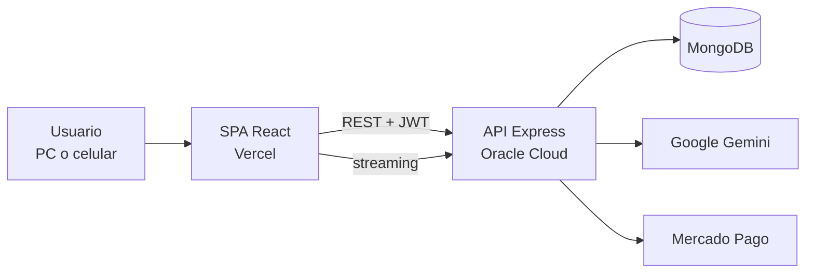

# Costify — FrontEnd

> **Sistema de gestión para talleres que fabrican a medida.** Calcula el costo y el precio de venta de cada trabajo, sigue cada venta desde la seña hasta la entrega, controla la plata del negocio y suma un **asistente de IA** que consulta y opera sobre los datos reales.
>
> Este repositorio es el **frontend**: una SPA en React 19 + Vite + Chakra UI. La API está en [Costify-BackEnd](https://github.com/SebaGarea/Costify-BackEnd).


**🖥️ App en producción:** [elportalherreria.vercel.app](https://elportalherreria.vercel.app) (acceso por invitación) · **📚 Documentación de la API:** [costify.duckdns.org/api-docs](https://costify.duckdns.org/api-docs)

<p align="center">
  <a href="https://costify-fron-end-ebw7.vercel.app"></a>
</p>

> **Demo pública:** usuario `demo@costify.com` · contraseña `Demo1234` (ya vienen cargados en el login). Tiene datos ficticios que se reinician todas las noches. El asistente de IA está desactivado en la demo para no consumir cuota: responde explicando qué hace.

---

## 🧭 ¿Qué es Costify?

Costify nació para resolver un problema real de **El Portal — Herrería Artística**, un taller de herrería y carpintería a medida. Cada trabajo es distinto, los precios del hierro y la pintura cambian seguido y parte de las ventas sale por Mercado Libre, con comisiones que hay que contemplar al poner precio.

La app reúne en un solo lugar lo que antes estaba disperso:

| Necesidad del taller | Cómo lo resuelve Costify |
|---|---|
| "¿Cuánto cobro este trabajo?" | **Plantillas de costo** que calculan costo, ganancia y precio final, también **por plataforma** (Mercado Libre, Tienda Nube). |
| "Subió el hierro, ¿quedaron viejos los precios?" | El precio de cada producto se **recalcula en vivo** desde su plantilla. |
| "¿Qué hay que entregar esta semana? ¿Quién debe plata?" | **Ventas** con seña, saldo y entrega, más un **calendario** y un **dashboard** con atrasos y pendientes. |
| "¿Cuánta plata tenemos y en qué se fue?" | **Caja**: efectivo y Mercado Pago, gastos por categoría, plata **a liberar** y **retiros de cada socio**. |
| "¿Qué hay que comprar?" | **Lista de compras** por sección que, al marcar "comprado", descuenta el gasto de la Caja. |
| "No tengo tiempo de navegar pantallas" | **Asistente de IA** en un chat: consulta y ejecuta acciones con lenguaje natural. |

---

## ✨ Funcionalidades por sección

### 📊 Inicio: dashboard y calendario
- **Métricas del negocio**:
  - facturación y ticket promedio;
  - saldo pendiente de cobro y margen estimado;
  - producto estrella;
  - rankings por medio de venta y por producto.
- **Entregas próximas y atrasadas** de un vistazo.
- **Calendario unificado** ([FullCalendar](https://fullcalendar.io/)): entregas de ventas, tareas y eventos manuales en una sola vista.

### 🧾 Plantillas de costo (presupuestos)
- **Secciones**: Herrería, Carpintería, Pintura y Otros, colapsables, con materiales, consumibles y extras.
- **Barra fija** con costo, ganancia y precio final en vivo, aviso de "cambios sin guardar" y fecha de la última modificación.
- **Pintura calculada por perfil de hierro**: la superficie sale sola de los metros usados.
- **Precios por plataforma**: Mercado Libre (planes con cuotas) y Tienda Nube.
- **Adjuntos y comentarios**: planos en PDF, fotos y notas del presupuesto.

### 📦 Productos y materias primas
- **Catálogo**: productos con galería de imágenes, stock y precio vinculado a su plantilla.
- **Materias primas**: categorías, medidas y stock, con **importación masiva desde Excel**.

### 💼 Ventas
- **Ciclo completo**: pendiente → en proceso → finalizada → despachada (o cancelada).
- **Cobro**: seña, saldo, cobros parciales y "marcar pagada".
- **Datos de la venta**: cliente, medio de venta y fecha de entrega.
- **Filtros** por estado, incluido "sin despachar".

### 💰 Caja
- **Una tarjeta por cuenta**: Efectivo, Mercado Pago y otras.
  - Mercado Pago muestra por separado lo **disponible** y lo **a liberar**.
  - **"Ajustar saldo"** lleva cada cuenta a su valor real.
- **KPIs del período**: ingresos, egresos y resultado.
- **Gráficos**: **gastos por categoría** y **flujo de los últimos 6 meses**.
- **Retiros de socios**: total por persona, con acceso rápido para registrar un retiro.
- **Movimientos**: ingresos, gastos y transferencias, con filtros, paginación y **exportación a Excel**.

### 🛒 Lista de compras y ✅ Tareas
- **Lista de compras** colaborativa por secciones, con totales y botón "Comprado" que registra el gasto.
- **Tareas** con prioridad, vencimiento, etiquetas, filtros y búsqueda, integradas al calendario.

### 🤖 Asistente de IA
- **Chat flotante y a pantalla completa**, con respuestas en **streaming** y formato Markdown.
- **Lee datos reales y ejecuta acciones**:
  - crea ventas, tareas y productos;
  - registra cobros y gastos;
  - marca entregas;
  - suma a la lista de compras.
- **Resumen del día** al abrirlo, indicador de "usando herramienta…" y **refresco en vivo** de las pantallas afectadas.

### 🔐 Acceso y experiencia
- **Formas de entrar**: email y contraseña, o **"Continuar con Google"**. El registro es **solo por invitación**.
- **Login con Google seguro**: el token nunca pasa por la URL; se canjea un código de un solo uso. Si algo falla, la pantalla explica por qué (sin cuenta, cancelado, vencido).
- **Contraseña**: botón para **mostrarla u ocultarla**; al cambiarla se cierran las sesiones en otros dispositivos.
- **Diseño responsive** (pensado para usar en el taller desde el celular) y **modo claro/oscuro**.

---

## 🛠️ Stack tecnológico

| Categoría | Tecnologías |
|---|---|
| **Framework / Build** | [React 19](https://react.dev/), [Vite 7](https://vitejs.dev/) |
| **UI** | [Chakra UI](https://chakra-ui.com/), [Framer Motion](https://www.framer.com/motion/), React Icons |
| **Datos / HTTP** | [TanStack Query](https://tanstack.com/query), Axios, Fetch API (streaming del chat) |
| **Calendario** | [FullCalendar](https://fullcalendar.io/) |
| **Drag & Drop** | [dnd-kit](https://dndkit.com/) |
| **Excel** | xlsx-js-style (exportaciones con formato) |
| **Markdown** | react-markdown (respuestas de la IA) |
| **Routing** | React Router 7, con rutas protegidas |
| **Calidad** | ESLint |
| **Despliegue** | [Vercel](https://vercel.com/) |

---

## 🏗️ Arquitectura



```
src/
├── components/   # vistas por módulo: Caja, Ventas, Plantillas, Chat, Login…
├── pages/        # páginas enrutadas
├── router/       # rutas y protección de rutas privadas
├── hooks/        # custom hooks por dominio (auth, caja, ventas, tareas…)
├── services/     # capa de acceso a la API (axios + interceptores)
├── context/      # estado global (chat)
├── layouts/      # layout principal y sidebar
├── constants/    # reglas de negocio compartidas (precios por plataforma…)
└── theme/        # tema de Chakra UI
```

---

## 📦 Instalación local

Requisitos: Node.js 18+ y la [API](https://github.com/SebaGarea/Costify-BackEnd) corriendo (local o desplegada).

```bash
git clone https://github.com/SebaGarea/Costify-FronEnd.git
cd Costify-FronEnd
npm install

# URL de la API
echo "VITE_API_URL=http://localhost:8080" > .env.development

npm run dev       # http://localhost:5173
npm run build     # build de producción (dist/)
npm run lint
```

---

## ☁️ Despliegue

- **Frontend** en **Vercel**, con despliegue automático al actualizar `main`.
- **API** en un contenedor Docker en **Oracle Cloud**, detrás de Caddy con HTTPS automático.
- **Flujo de ramas**: todo se desarrolla y prueba en `dev`. A `main` (producción) llega solo lo aprobado.

---

## 🗺️ Roadmap

- [x] Plantillas de costo con precios por plataforma
- [x] Ventas, tareas, calendario y dashboard
- [x] Asistente de IA con acciones sobre el negocio
- [x] Caja con cuentas, categorías y retiros de socios
- [x] Login con Google seguro y auditoría de autenticación
- [ ] Tests con Vitest y Testing Library
- [ ] Exportación de presupuestos a PDF
- [ ] PWA con modo offline

---

## 👨‍💻 Autor

Desarrollado por **[Sebastián Garea](https://github.com/SebaGarea)**: diseño, desarrollo full-stack, despliegue y mantenimiento de una app que usa un negocio real.

[](https://www.linkedin.com/in/sebastian-garea-5713ba307/)
[](https://github.com/SebaGarea)
